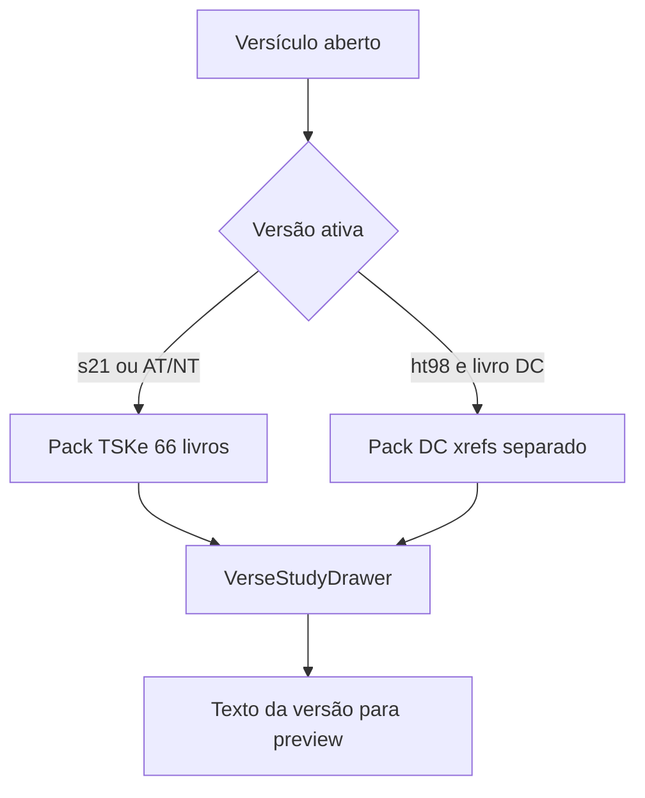

# Bíblia de estudo (âmbito Biblos)

> **État app :** as **références croisées (TSKe)** estão activas no painel de estudo do versículo.
> Strong / Sg1910 permanecem no ETL para trabalho posterior.

Recursos suportados na app:

| Recurso | ID | Uso |
|--------|-----|-----|
| Segond 21 | `s21` | Texto principal, áudio, offline, busca |
| Haïtienne 1998 | `ht98` | Texto (`/bibles/ht1998.json`) |
| Références croisées | TSKe | Painel « Référence croisée » (`/bible/study/tske/{USFM}.{ch}.json`) |
| Segond 1910 + Strong | `sg1910` | ETL local (não obrigatório no deploy) |
| Léxico Strong | H/G | ETL local (não obrigatório no deploy) |

## Gerar e incluir no deploy

O ficheiro `estudo-biblia-compilado.txt` **não** vai para o git. Extração local:

```bash
npm run bible:study:export
npm run bible:study:stage
```

- `data/bible/study/tske/` — **versionado** (necessário para Vercel/APK)
- `public/bible/study/` — gerado no `npm run build` via `stage-study-assets.mjs`
- `strong/` e `sg1910/` — locais / opcionais no stage

`npm run build` e `build:mobile` já correm o stage de study depois do S21.

## Offline (refs croisées)

| Camada | Comportamento |
|--------|----------------|
| Leitura | `loadTskeChapter`: RAM → IndexedDB (`biblos-tske-offline`) → fetch asset |
| Pack | Ao descarregar / seed da Bible S21 hors ligne, corre `ensureTskeOfflinePack()` (manifest) |
| PWA | Workbox `CacheFirst` em `/bible/study/tske/` |
| Manifest | `public/bible/study/tske/manifest.json` gerado no stage |

Sem rede, as refs usam o pack IDB (ou o cache HTTP / assets Capacitor).

## Licenças

- Sg1910 / TSKe: conforme as fontes MySword / concordance.bible referenciadas no compilado.
- Não incluir Nave, ISBE, LSG paralelo, interlinear ou outros módulos fora deste âmbito.

## Backlog (ideia) — refs cruzadas deuterocanônicas

> **Não implementar agora.** Apenas mapa de encaixe para decisão futura.

### O que é possível hoje

| Peça | Estado |
|------|--------|
| Texto DC | Só em **HT98** (`TOB`, `JDT`, `WIS`, `SIR`, `BAR`, `1MA`, `2MA`, … — ver [`searchTestamentSets.ts`](../src/bible/searchTestamentSets.ts)) |
| Busca DC | Pill / filtro `dc` na word-search (HT98) |
| Painel estudo | [`VerseStudyDrawer`](../src/components/VerseStudyDrawer.tsx) → [`loadVerseStudy`](../src/bible/studyQueries.ts) → TSKe |
| Offline TSKe | Pack IndexedDB + assets `data/bible/study/tske/` (cânon protestante 66 livros) |
| Preview da ref | [`crossRefPassageText`](../src/bible/crossRefPassageText.ts) na versão ativa (`s21` / `ht98`) |

Em S21, livros DC **não existem** no texto; o estudo de um versículo S21/HT (AT/NT) já mostra refs TSKe para o cânon de 66 livros.

### O que o TSKe **não** cobre

O pack TSKe embutido **não tem** capítulos fonte deuterocanônicos (`TOB.*`, `WIS.*`, etc.). O TSK clássico indexa o cânon protestante; abrir estudo em Tobie/Sagesse no HT98 → capítulo TSKe ausente → `unavailable` / lista vazia.

Também faltam aliases USFM DC em [`usfm.ts`](../src/youversion/usfm.ts) se alguma fonte citar `Tob`, `Wis`, `Sir`, …

### Encaixe recomendado (quando for prioridade)



1. **Fonte de dados** — dataset DC dedicado (ex. [Catholic Cross-References](https://github.com/jesuslovestyler/Catholic-Cross-References), domínio público), **não** misturar dentro dos JSON TSKe atuais.
2. **Formato interno** — normalizar para o mesmo contrato que TSKe (`body` / `refs` → `parseTskeBody` ou parser irmão) + stage em `data/bible/study/dc-xrefs/` (nome a definir).
3. **Loader** — em `loadVerseStudy` / `studyQueries`: se `isDcBook(bookId)` e versão com DC (HT98), ler pack DC; senão TSKe.
4. **Aliases** — mapear abreviações DC → USFM em `usfm.ts` / `knownBookCode`.
5. **Offline** — espelhar o padrão `idbTskeCache` + manifest (pack opcional no first-install HT, ou sob pedido).
6. **UX** — mesmo painel « Référence croisée »; sem segunda UI. Em S21, DC continua inexistente (só links *para* DC fariam sentido se o preview falhar → já há `study.refUnavailable`).

### Fora de âmbito deste backlog

- Reescrever o TSKe protestante
- Mostrar refs DC como se fossem TSKe
- Strong / léxico para livros DC
- Implementação ou ETL nesta entrega

### Ficheiros que tocariam numa implementação futura

- [`src/bible/studyQueries.ts`](../src/bible/studyQueries.ts) — escolha TSKe vs pack DC
- [`src/bible/tske.ts`](../src/bible/tske.ts) / novo `dcXrefs.ts` — parse + load
- [`src/bible/searchTestamentSets.ts`](../src/bible/searchTestamentSets.ts) — IDs DC (já existem)
- [`src/youversion/usfm.ts`](../src/youversion/usfm.ts) — aliases
- `data/bible/study/` + `stage-study-assets` + offline pack
- [`docs/bible-product-scope.md`](./bible-product-scope.md) — promover de backlog a «incluído» só após ship
