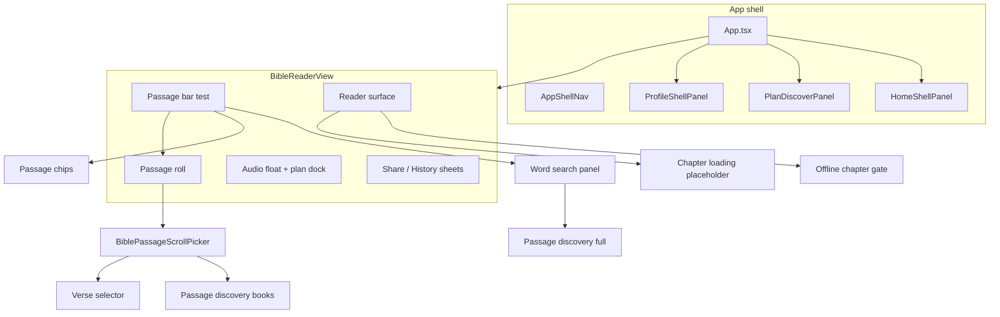

# Bibloscomponents

Documento **único** que reúne todos os módulos de UI documentados em `docs/components/`. Cada secção resume responsabilidade, ficheiros-chave e ligação ao guia detalhado. Use este ficheiro para orientação rápida; alterações arquitecturais devem actualizar o módulo individual e depois este índice.

---

## Arquitectura em camadas

---

## Índice mestre

| ID | Nome | Guia detalhado |
|----|------|----------------|
| `app-shell` | Shell, tabs, painéis Accueil/Plan/Bible/Profil | [app-shell.md](./app-shell.md) |
| `reader-surface` | Capítulo, versículos, seleção, acções | [reader-surface.md](./reader-surface.md) |
| `passage-bar` | Estado actual da barra (chip + search + FAB skips) | [passage-bar.md](./passage-bar.md) |
| `passage-roll` | Barra referência + contentor roll | [passage-roll.md](./passage-roll.md) |
| `passage-chips` | Chips livro/capítulo / ref | [passage-chips.md](./passage-chips.md) |
| `passage-scroll-picker` | Painel picker (3 passos) | [passage-scroll-picker.md](./passage-scroll-picker.md) |
| `passage-discovery` | Busca e lista de livros | [passage-discovery.md](./passage-discovery.md) |
| `passage-verse-selector` | Grelha de versículos | [barra-seletor-versiculo.md](./barra-seletor-versiculo.md) |
| `audio-float` | Play/seek áudio S21 | [audio-float.md](./audio-float.md) |
| `share-history` | Partilha e histórico | [share-history.md](./share-history.md) |
| `study-sheets` | TSKe, Strong, busca global | [study-sheets.md](./study-sheets.md) |

---

## Shell da aplicação (`app-shell`)

**Ficheiros:** `App.tsx`, `AppShellNav.tsx`, `HomeShellPanel.tsx`, `ProfileShellPanel.tsx`, `shellNav.ts`, `features/reading-plans/PlanDiscoverPanel`.

Quatro tabs persistidas em `localStorage`; o leitor permanece montado após a primeira visita. Narrow esconde a nav durante leitura imersiva. Rota `#admin` desvia para CMS editorial. Home e Perfil consomem `activityLog` para retomar leitura.

→ [app-shell.md](./app-shell.md)

---

## Superfície de leitura (`reader-surface`)

**Ficheiros:** `BibleReaderView.tsx`, `usePassageViewModel.ts`, `BibleChapterLoadingPlaceholder.tsx`, `BibleOfflineChapterGate.tsx`, `passageReducer` / `passagePresentation`.

ViewModel reduz carga de capítulo; a UI alterna entre gate offline, skeleton e versículos clicáveis. Seleção abre sheet de marcas/partilha/flashcard. Overlays coordenam-se via `readerSurfaceChrome` (inert, scrim, chrome forçado).

→ [reader-surface.md](./reader-surface.md)

---

## Bloco passage picker

### Passage bar — estado actual (`passage-bar`)

Layout `test`: ícone **search** (palavras) + **chip** `ref` (livros/capítulos), hamburger no header, setas capítulo no FAB inferior direito. Pesquisa desacoplada (`scope: books` vs `full`).

→ [passage-bar.md](./passage-bar.md)

### Passage roll (`passage-roll`)

Contentor `.bible-yv-passage-roll`: barra + picker, fecho por scrim/toque exterior, `passagePickerRollOpen` gated pelo catálogo.

→ [passage-roll.md](./passage-roll.md)

### Chips (`passage-chips`)

`BiblePassageChip` — variantes `book` / `chapter` / `ref`; no layout test o chip unificado faz toggle do dropdown.

→ [passage-chips.md](./passage-chips.md)

### Painel scroll (`passage-scroll-picker`)

`BiblePassageScrollPicker` — componente controlado; com `discoveryBooksOnly` o campo do passo livro só filtra catálogo/refs.

→ [passage-scroll-picker.md](./passage-scroll-picker.md)

### Descoberta (`passage-discovery`)

Lista AT/NT, saltos de referência; pesquisa de **palavras** no painel do ícone (`BiblePassageWordSearchPanel`). Hook `usePassageDiscovery` com `scope: "books" | "full"`.

→ [passage-discovery.md](./passage-discovery.md) · [passage-bar.md](./passage-bar.md)

### Seletor de versículos (`passage-verse-selector`)

Passo `verse`: `pickerVerseNumberOptions`, skeleton até `PassagePresentation` estabilizar, `jumpToVerse` no leitor.

→ [barra-seletor-versiculo.md](./barra-seletor-versiculo.md)

---

## Áudio (`audio-float`)

`BibleAudioFloat` no dock — UI de play/seek; estado de áudio e sync em `BibleReaderView` / `bibleChapterAudioSync`.

→ [audio-float.md](./audio-float.md) · [bible-mobile-audio-sync.md](../bible-mobile-audio-sync.md)

---

## Partilha e histórico (`share-history`)

`BibleShareSheet` (versículo ou plano, cartão + URL); `BibleHistorySheet` no leitor; histórico espelhado no perfil. Dados em `activityLog` e `shareVerse*`.

→ [share-history.md](./share-history.md)

---

## Estudo e busca (`study-sheets`)

`BibleStudySheet`, `BibleStrongSheet`, `BibleSearchSheet` — implementados, **sem mount** no leitor actual; ver [bible-study.md](../bible-study.md) para âmbito de dados.

→ [study-sheets.md](./study-sheets.md)

---

## Peças auxiliares (sem módulo próprio)

| Peça | Ficheiro | Nota |
|------|----------|------|
| `YvIcon` | `src/components/YvIcon.tsx` | Ícones Material; ver [icons.md](../icons.md) |
| `ModeTabIcon` | `ModeTabIcon.tsx` | Ícones das tabs shell |
| `BiblePickGridSkeleton` | picker capítulo/versículo | [skeleton-architecture.md](../skeleton-architecture.md) |
| `BibleSearchHighlight` | realce query | discovery + search sheet |
| `CircularColorEditor` | marcas de versículo | dentro do sheet de acções |
| `AppSettingsPanel` | painel settings | não ligado ao `App` |
| `BibleHistoryPanel` | histórico embed | alternativa ao sheet |
| `EditorialAdminApp` | CMS planos | feature `editorial-auth`, rota hash |

---

## ViewState partilhado (referência cruzada)

| Ficheiro | Consumidores |
|----------|----------------|
| `bibleChrome.ts` | Chips, abertura roll |
| `readerSurfaceChrome.ts` | Roll, tools, share, history, verse actions |
| `passagePickerChrome.ts` | Passo versículo no picker |
| `pickerVerseOptions.ts` | Lista números versículo |
| `audioViewState.ts` | Audio float |
| `passageReducer` / `selectors` | Superfície de leitura |

---

## Documentação relacionada

- [architecture-guide.md](../architecture-guide.md) — princípios gerais
- [components/README.md](./README.md) — convenções e modelo de secções
- [skeleton-architecture.md](../skeleton-architecture.md) — loading UI
- [bible-offline-first-ui.md](../bible-offline-first-ui.md) — offline, inert, QA

---

_Última actualização: 2026-11-10_
