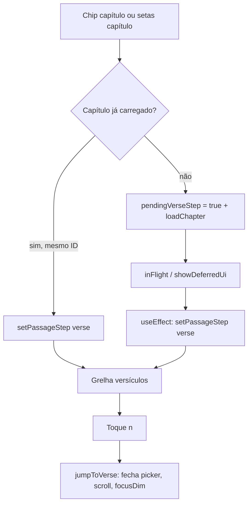

# Módulo: barra e grelha seletora de versículos

| Campo | Valor |
|-------|--------|
| **ID** | `passage-verse-selector` |
| **Superfície** | Passo **Verset** do painel roll (cabeçalho com voltar + grelha numérica de versículos) |
| **Dono do estado** | `BibleReaderView` |
| **Renderização** | Ramo `step === "verse"` em `BiblePassageScrollPicker` |

O utilizador chega aqui depois de escolher um capítulo (mesmo livro/capítulo já carregado ou após `loadChapter`). Não existe chip «versículo» na barra superior — o capítulo abre automaticamente este passo quando `pendingVerseStep` conclui.

---

## Resumo

- **Objetivo:** saltar para um versículo no capítulo atual sem fechar o contexto livro/capítulo.
- **Saída principal:** `onJumpVerse(n)` → `jumpToVerse` no leitor (fecha o picker, scroll + foco YouVersion no versículo).
- **Durante carga:** grelha skeleton + mensagem `pickerVerseOpening` até `PassagePresentation.showDeferredUi` ser falso.
- **Destaque visual:** célula `is-on` se `highlightVerse === n` ou se o versículo está na seleção multi (`verseSelected`).

---

## Mapa de ficheiros

| Papel | Caminho |
|-------|---------|
| UI do passo versículo | `src/components/BiblePassageScrollPicker.tsx` |
| Orquestração | `src/components/BibleReaderView.tsx` (`jumpToVerse`, `pickChapter`, `verseOptions`, `passageStep`) |
| Lista de números | `src/bible/viewState/pickerVerseOptions.ts` |
| Chrome de carga | `src/bible/viewState/passagePickerChrome.ts` |
| Skeleton da grelha | `src/bible/viewState/pickerViewState.ts` (`buildVersePickerSkeleton`) |
| Células loading | `src/components/BiblePickGridSkeleton.tsx` |
| Textos de loading | `src/bible/viewState/loadingConstants.ts` |
| Estilos | `src/index.css` (`.bible-yv-passage-scroll-panel`, `.bible-yv-pick-roll-subhead`, `.bible-yv-pick-cell`) |

**Pai imediato:** `renderPassageRoll` → contentor `.bible-yv-passage-roll` + `BiblePassageScrollPicker` com `step={passageStep}`.

---

## Fluxo do utilizador



1. **Entrada rápida:** `pickChapter` — se `nextChapter === chapterId` e já há `passage.verses`, vai direto ao passo `verse`.
2. **Entrada com fetch:** novo capítulo → `pendingVerseStep.current = true`; quando `presentation.inFlight` termina, `useEffect` faz `setPassageStep("verse")`.
3. **Saída:** `handlePickBack` no passo `verse` regressa a `chapter` (não fecha o roll).
4. **Dismiss:** escolher versículo chama `jumpToVerse` e `setPickerOpen(false)` (roll fecha).

---

## Contratos (`BiblePassageScrollPicker`)

Props que afetam só o passo **verse**:

| Prop | Tipo | Origem em `BibleReaderView` |
|------|------|-----------------------------|
| `step` | `"book" \| "chapter" \| "verse"` | `passageStep` |
| `open` | `boolean` | `passageRollOpen` |
| `verseOptions` | `number[]` | `pickerVerseNumberOptions({...})` |
| `passageChrome` | `PassagePickerChrome` | `passagePickerChromeFromPresentation` |
| `highlightVerse` | `number \| null` | estado local |
| `verseSelected` | `(n) => boolean` | `verseInSelection(selection, n)` |
| `onJumpVerse` | `(n) => void` | `jumpToVerse` |
| `onBack` | `() => void` | `handlePickBack` |
| `bookTitle`, `chapterId` | `string` | contexto ARIA / labels |

O painel só monta conteúdo quando `open === true` (`if (!open) return null`).

---

## Estado e orquestração

### `jumpToVerse(number)`

Efeitos colaterais intencionais (não mover para o picker sem rever leitor):

- `preferJumpFocusRef.current = true` — prioriza foco do salto sobre janela de plano.
- `pendingScrollVerse` com `mode: "start"` — scroll programático no corpo do capítulo.
- Limpa `selection`, define `highlightVerse`, activa `focusDim` (texto opaco até primeiro scroll).
- Fecha picker (`setPickerOpen(false)`).

### `verseOptions` (anti-stale)

`pickerVerseNumberOptions` evita listar versículos do **capítulo anterior** enquanto o USFM alvo ainda não bate certo:

1. Se `passage.verses` existe e `passage.id` === USFM alvo → números reais.
2. Senão, se `activeSchema` coincide com o capítulo → `1..verseCount`.
3. Fallback → último `passage` conhecido ou `[]`.

### Transição automática para `verse`

```text
pendingVerseStep (ref) + pickerOpen + !presentation.inFlight → setPassageStep("verse")
```

Cancelar roll (`closePicker`) repõe `pendingVerseStep.current = false`.

### Abertura do roll

`passagePickerRollOpen(pickerOpen, pickerPanelOpenAllowed)` — o passo versículo **não** aparece se o catálogo ainda não permite abrir o painel (`biblePickerChrome`).

---

## ViewState e carregamento

### `PassagePickerChrome`

| Campo | Uso no passo verse |
|-------|---------------------|
| `inFlight` | `disabled` nos botões da grelha |
| `showDeferredUi` | mostra `BiblePickGridSkeleton` em vez de botões |
| `schema` | dimensão do skeleton via `buildVersePickerSkeleton` |

Enquanto `showDeferredUi`:

- Grelha: `BiblePickGridSkeleton` com schema USFM + slots (`gridVerseSlots` ou estimativa `min(50, max(len, 24))`).
- Rodapé: `role="status"` com `PASSAGE_LOADING_COPY.pickerVerseOpening`.

Quando `!showDeferredUi && !verseOptions.length` → «Aucun verset».

### Skeleton

Ver [skeleton-architecture.md](../skeleton-architecture.md): células `skeleton-picker-cell` mantêm altura da grelha (sem colapso do painel).

---

## UI (estrutura DOM)

Passo `verse` em `BiblePassageScrollPicker`:

1. **Subbarra** `.bible-yv-pick-roll-subhead`
   - Botão voltar → capítulos (`onBack`)
   - Label fixa «Verset»
2. **Grelha** `.bible-yv-pick-grid` + `role="listbox"`
   - Botões `.bible-yv-pick-cell` com `role="option"`, `aria-selected={on}`
3. **Borda** `.bible-yv-passage-scroll-edge` (decorativa)

Classes no painel: `bible-yv-passage-scroll-panel is-open is-header-roll is-verse`.

`aria-label` do diálogo: `Versets du chapitre ${chapterId}`.

---

## Acessibilidade

| Elemento | Comportamento |
|----------|----------------|
| Painel | `role="dialog"`, `aria-modal="false"`, `aria-label` por passo |
| Grelha | `role="listbox"`; células `role="option"` |
| Voltar | `aria-label` com título do livro |
| Loading | `role="status"` na mensagem de abertura |
| Skeleton | `role="presentation"` na grelha skeleton |

**Foco ao abrir picker:** com `passageStep !== "book"`, o foco vai para o chip de capítulo (`.bible-yv-passage-chip.is-chapter`), não para a grelha de versículos — relevante se testares teclado após transição automática para `verse`.

---

## Casos limite

| Situação | Comportamento esperado |
|----------|------------------------|
| Catálogo a hidratar | roll não abre; chips `is-hydrating` |
| `loadChapter` em curso | células desactivadas; skeleton se `showDeferredUi` |
| Seleção multi activa no leitor | versículos na seleção aparecem `is-on` na grelha |
| Mesmo capítulo, picker aberto | `pickChapter` só muda passo, sem novo fetch |
| Descoberta com versículo | `pickVerseSearchHit` / `pickDiscoveryJump` fecham picker; podem definir `pendingVerseStep` no jump |

---

## Alterações seguras

- Ajustar copy FR em `loadingConstants` ou labels ARIA no picker.
- Alterar morfologia do skeleton via `buildVersePickerSkeleton` / `activeSchema.gridVerseSlots`.
- Melhorar destaque `is-on` (CSS apenas) sem mudar `jumpToVerse`.

## Anti-padrões

- Calcular `verseOptions` só a partir de `passage.verses` sem validar USFM → lista stale após mudança de capítulo.
- Abrir passo `verse` sem `pendingVerseStep` ou sem versículos carregados quando o capítulo mudou.
- Duplicar lógica `showDeferredUi` fora de `PassagePresentation` / `passagePickerChromeFromPresentation`.
- Mover `jumpToVerse` para dentro do picker — quebra sincronização com scroll, cartão de versículo e `focusDim`.

---

## Ligações

- [skeleton-architecture.md](../skeleton-architecture.md)
- [bible-offline-first-ui.md](../bible-offline-first-ui.md) — `passagePickerRollOpen`, scrim, inert
- [passage-roll.md](./passage-roll.md) · [passage-chips.md](./passage-chips.md) · [passage-discovery.md](./passage-discovery.md) · [README](./README.md)
