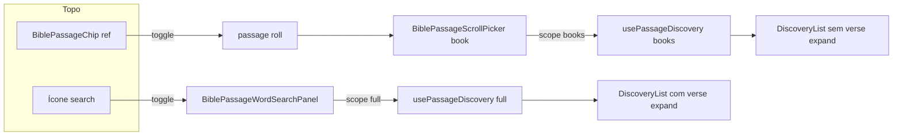
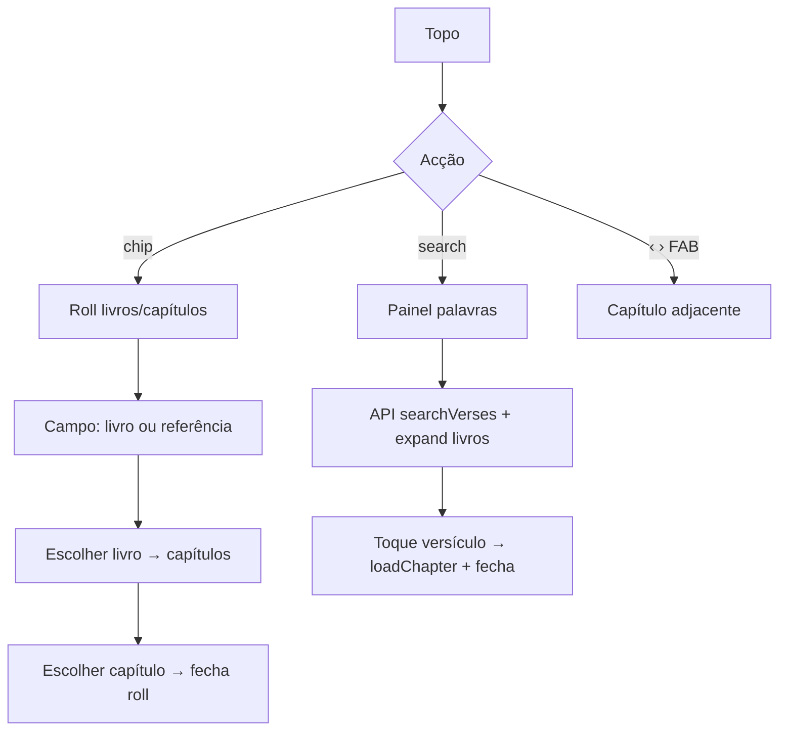

# Módulo: BiblePassageBar (estado actual — layout `test`)

| Campo | Valor |
|-------|--------|
| **ID** | `passage-bar` |
| **Superfície** | Chrome de referência no topo do leitor: ícone search + chip livro/capítulo (+ hamburger; setas capítulo no FAB) |
| **Dono do estado** | `BibleReaderView` |
| **Layout flag** | `data-passage-bar-panel="test"` (`passageBarPanelLayout.ts`) |

Documento do **estado actual** da barra após o fluxo `test`: chip dropdown, pesquisa desacoplada (livros vs palavras), sem passo versículo automático após capítulo, setas no canto inferior direito.

---

## Resumo visual (narrow / free reading)

```text
┌─────────────────────────────────────────────┐
│ [🔍]  [ Jean 1 ▾ ]              [ ☰ ]       │  ← topo
│                                             │
│         (texto do capítulo)                 │
│                                             │
│ [▶]                              [ ‹  › ]   │  ← FAB (play / skips)
└─────────────────────────────────────────────┘
```

| Peça | Componente / render | Papel |
|------|---------------------|--------|
| Ícone search | `bible-yv-passage-word-search-trigger` | Abre painel de **palavras** |
| Chip título | `BiblePassageChip` (`variant="ref"`) | Abre roll de **livros/capítulos** |
| Menu | `renderTopToolsMenu("header")` | Ferramentas Bible (activo) |
| Setas capítulo | `renderPassageChapterSkips` + `is-float-br` | Capítulo anterior/seguinte |

---

## Duas superfícies de pesquisa (desacopladas)

| | Pill / passo livro | Ícone search |
|--|--------------------|--------------|
| **UI** | Campo em `BiblePassageScrollPicker` (passo `book`) | `BiblePassageWordSearchPanel` |
| **Query state** | `bookSearchQuery` | `wordSearchQuery` |
| **Sessão scroll** | `discoverySession` | `wordDiscoverySession` |
| **Hook** | `usePassageDiscovery(..., "books")` | `usePassageDiscovery(..., "full")` |
| **Scope** | Só títulos + saltos de referência | Conteúdo (API) + expansão de versículos |
| **Placeholder** | «Livre ou référence…» | «Mot ou expression…» |

Flag: `passageDiscoverySplitSearch()` em `src/bible/passageDiscoveryFlow.ts`  
(requer layout `passage-bar-panel=test` + `VITE_PASSAGE_DISCOVERY_FLOW` ≠ `legacy`).



Os dois overlays **excluem-se**: abrir search fecha o picker; abrir o chip fecha o search.

---

## Chip book selector (`BiblePassageChip`)

| Campo | Valor |
|-------|--------|
| **Ficheiro** | `src/components/BiblePassageChip.tsx` |
| **Variante actual (test)** | `ref` — livro + número de capítulo no mesmo pill |
| **Montagem** | `renderTopPassageNav` em `BibleReaderView` |
| **Doc detalhado** | [passage-chips.md](./passage-chips.md) |

### Contrato relevante

| Prop | Uso actual |
|------|------------|
| `variant="ref"` | Layout unificado (`isPassagePillUnified`) |
| `label` / `chapterLabel` | Título do livro + `chapterId` |
| `open` | `passageRollOpen` e passo `book` \| `chapter` |
| `panelId` | `aria-controls` do painel roll |
| `onClick` | `togglePassagePickerRef` — **abre e fecha** (2.º clique) |

### Comportamento dropdown

1. Clique → `openPassagePicker` (fecha word search se aberto).
2. Caret roda 180° (`is-open`).
3. Segundo clique no chip → `closePicker`.
4. Esc / toque fora / scrim → fecha.

Com layout `test`, a barra **mantém** o mesmo chrome visual aberto/fechado (setas do topo já não fazem parte do pill; skips estão no FAB).

---

## Ícone + painel de pesquisa de palavras

| Campo | Valor |
|-------|--------|
| **Trigger** | Botão à esquerda do chip (cluster `.bible-yv-passage-chrome-cluster`) |
| **Painel** | `src/components/BiblePassageWordSearchPanel.tsx` |
| **Lista** | Reutiliza `BiblePassageDiscoveryList` + `BiblePassageDiscoveryBookRow` |
| **Doc discovery** | [passage-discovery.md](./passage-discovery.md) |

### Estado em `BibleReaderView`

| Estado | Função |
|--------|--------|
| `wordSearchOpen` | Overlay aberto |
| `wordSearchQuery` | Texto do campo palavras |
| `wordDiscoverySession` | Scroll / livro expandido / âncora USFM |
| `toggleWordSearch` / `closeWordSearch` | Abertura exclusão mútua com picker |

### Chrome de superfície

`readerSurfaceChrome({ wordSearchOpen })` — mesmo tratamento que o roll: `inert` na passagem, scrim, `forceChromeVisible`.

Dismiss: pointer fora do cluster (excepto o botão trigger), Escape.

---

## Passo livro no roll (só catálogo)

Quando `discoveryBooksOnly` / scope `"books"`:

- `usePassageDiscovery` **não** chama `searchVersesForVersion`.
- `BiblePassageDiscoveryList` recebe `verseDiscoveryEnabled={false}` — linhas de livro **não** expandem hits de conteúdo.
- Saltos «Aller à …» (`buildDiscoveryJumps`) continuam activos se a query for uma referência parseável.

---

## Flags de produto (estado `test` por omissão)

| Variável / query | Default | Efeito |
|------------------|---------|--------|
| `VITE_PASSAGE_BAR_PANEL_LAYOUT` / `?passage-bar-panel=` | `test` | Barra compacta, chip dropdown, skips FAB |
| `VITE_PASSAGE_DISCOVERY_FLOW` | `test` | Split livros (pill) / palavras (ícone) |
| `VITE_PASSAGE_PICKER_FLOW` | `test` | Sem passo VERSET após escolher capítulo |
| `VITE_PASSAGE_BAR_SKIP_ICONS` | `test` | Chevrons nas setas de capítulo |
| `VITE_PASSAGE_PILL` | `test` | Chip `ref` unificado |

`legacy` / `0` / `off` repõe o comportamento anterior em cada eixo.

---

## Mapa de ficheiros

| Papel | Caminho |
|-------|---------|
| Orquestração | `src/components/BibleReaderView.tsx` |
| Chip | `src/components/BiblePassageChip.tsx` |
| Roll / picker | `src/components/BiblePassageScrollPicker.tsx` |
| Painel palavras | `src/components/BiblePassageWordSearchPanel.tsx` |
| Lista discovery | `src/components/BiblePassageDiscoveryList.tsx` |
| Linha livro | `src/components/BiblePassageDiscoveryBookRow.tsx` |
| Hook discovery | `src/hooks/usePassageDiscovery.ts` (`scope: "books" \| "full"`) |
| Layout barra | `src/bible/passageBarPanelLayout.ts` |
| Split search | `src/bible/passageDiscoveryFlow.ts` |
| Skips icons | `src/bible/passageBarSkipIcons.ts` |
| Skip verse step | `src/bible/passagePickerFlow.ts` |
| Chrome overlays | `src/bible/viewState/readerSurfaceChrome.ts` |
| Estilos | `src/index.css` — `html[data-passage-bar-panel="test"]`, `.bible-yv-passage-word-search-*`, `.bible-yv-top-passage-skips.is-float-br` |

---

## Fluxo do utilizador (resumo)



Nota: o passo grelha **VERSET** após capítulo está desligado no fluxo `test` (`passagePickerSkipsVerseStep`).

---

## Acessibilidade

| Controlo | ARIA |
|----------|------|
| Chip | `aria-expanded`, `aria-controls` (painel roll), `aria-haspopup="dialog"`; label «Choisir» / «Replier» |
| Search trigger | `aria-expanded`, `aria-controls` (painel palavras) |
| Painéis | `role="dialog"`, `aria-modal="false"` |

---

## Alterações seguras / anti-padrões

**Seguro**

- Ajustar copy/placeholders dos dois campos sem misturar scopes.
- Estilos sob `html[data-passage-bar-panel="test"]` sem tocar no legacy.
- Evoluir `BiblePassageWordSearchPanel` reutilizando a lista discovery.

**Evitar**

- Voltar a passar a mesma `bookSearchQuery` aos dois painéis (mistura livros e palavras).
- Chamar `usePassageDiscovery` com scope `"full"` no passo livro do roll quando o split está activo.
- Declarar `const discoverySplitSearch = …` **depois** de um hook que o leia (TDZ — crash «Cannot access before initialization»).
- Esconder o hamburger no layout `test` (deve permanecer no header).

---

## Relação com outros docs

- [passage-chips.md](./passage-chips.md) — contrato do chip
- [passage-roll.md](./passage-roll.md) — contentor roll
- [passage-discovery.md](./passage-discovery.md) — domínio de descoberta
- [passage-scroll-picker.md](./passage-scroll-picker.md) — painel multi-passo
- [barra-seletor-versiculo.md](./barra-seletor-versiculo.md) — passo verse (legado / `legacy` flow)
