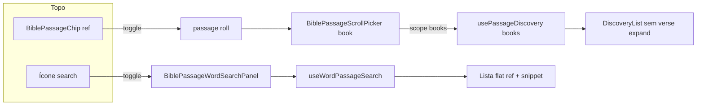
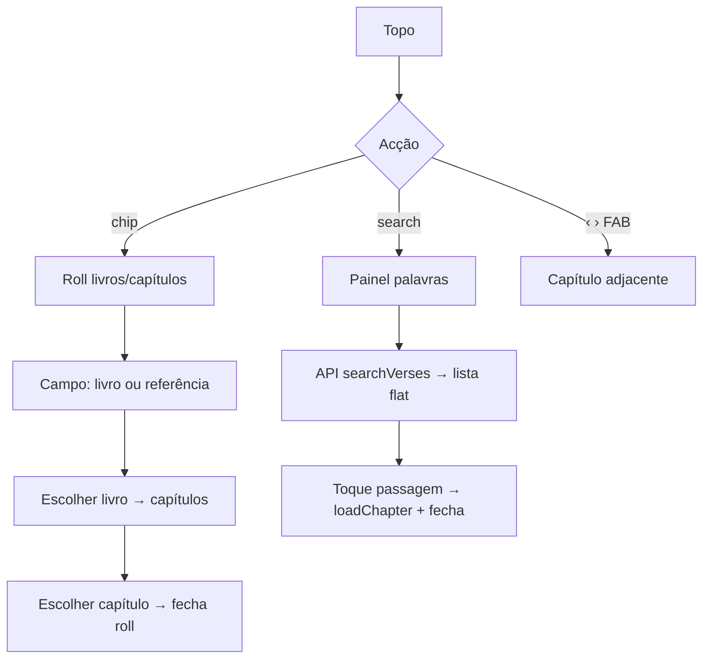

# Módulo: BiblePassageBar (estado actual — layout `test`)

| Campo | Valor |
|-------|--------|
| **ID** | `passage-bar` |
| **Superfície** | Chrome de referência no topo do leitor: ícone search + chip livro/capítulo (+ hamburger; setas capítulo no FAB) |
| **Dono do estado** | `BibleReaderView` |
| **Layout flag** | `data-passage-bar-panel="test"` (`passageBarPanelLayout.ts`) |

Documento do **estado actual** da barra após o fluxo `test`: chip dropdown, pesquisa desacoplada (livros vs palavras), sem passo versículo automático após capítulo, setas no canto inferior direito.

### Shell UI partilhado (chrome)

Cartões (scroll picker, word-search, tools popover) e FABs partilham tokens em `html[data-passage-bar-panel="test"]`. No topo, **modern UI**: search e hamburger são **ghost** (sem pill); só o **chip** traz superfície. Tamanhos alinhados à lógica mobile (`--mobile-touch`, `--mobile-chrome-gap`).

| Token / regra | Papel |
|-------|--------|
| `--bible-chrome-trigger-h` | `var(--mobile-touch)` — hit ≥ 44px (search, chip, ☰) |
| `--bible-chrome-trigger-icon` | 20px dentro do hit target |
| `--yv-chrome-surface` | Fill dos FABs (play idle / skips) — cinza `--surface` |
| Search / ☰ | Ghost: sem fill; hover = wash; aberto = outline só |
| Chip | `--yv-overlay-surface` (elevated) + `--yv-overlay-shadow` — primário no topo |
| Painéis / popover | `--yv-overlay-surface` (elevated) + `--yv-overlay-shadow` |
| `--bible-chrome-panel-radius` / `-pad` / `-gap` | Cartão overlay idêntico |
| `--bible-chrome-panel-offset-y` | `var(--mobile-chrome-gap)` |
| `--bible-chrome-panel-edge` | Fade inferior 4px nos dois painéis |
| `--bible-chrome-fab-size` / `-border` / `-shadow` | Touch + hairline + sombra FAB (play/skips) |
| Top bar | `border-bottom: var(--yv-separator)` |
| `--bible-audio-play-size` / `--bible-fab-lift` | Play = touch; lift = `play + 12px` |

Animação dos painéis: `opacity` + `translateY` (sem `scaleY`). Ver escala L0–L5 em [reader-surface.md](./reader-surface.md).

---

## Resumo visual (narrow / free reading)

```text
┌─────────────────────────────────────────────┐
│ [🔍]  [ Jean 1 ▾ ]              [ ☰ ]       │  ← topo
│                                             │
│         (texto do capítulo)                 │
│                                             │
│ [▶]                              [ ‹  › ]   │  ← FAB (play / skips)
└─────────────────────────────────────────────┘
```

| Peça | Componente / render | Papel |
|------|---------------------|--------|
| Ícone search | `bible-yv-passage-word-search-trigger` (ghost) | Abre painel de **palavras** |
| Chip título | `BiblePassageChip` (`variant="ref"`, superfície) | Abre roll de **livros/capítulos** |
| Menu | `renderTopToolsMenu("header")` (ghost) | Ferramentas Bible (activo) |
| Setas capítulo | `renderPassageChapterSkips` + `is-float-br` | Capítulo anterior/seguinte |

---

## Duas superfícies de pesquisa (desacopladas)

| | Pill / passo livro | Ícone search |
|--|--------------------|--------------|
| **UI** | Campo em `BiblePassageScrollPicker` (passo `book`) | `BiblePassageWordSearchPanel` |
| **Query state** | `bookSearchQuery` | `wordSearchQuery` |
| **Sessão scroll** | `discoverySession` | `wordDiscoverySession` |
| **Hook** | `usePassageDiscovery(..., "books")` | `useWordPassageSearch` |
| **Scope** | Só títulos + saltos de referência | Conteúdo (API) → lista flat de passagens |
| **Placeholder** | «Livre ou référence…» | «Mot ou expression…» |

Flag: `passageDiscoverySplitSearch()` em `src/bible/passageDiscoveryFlow.ts`  
(requer layout `passage-bar-panel=test` + `VITE_PASSAGE_DISCOVERY_FLOW` ≠ `legacy`).



Os dois overlays **excluem-se**: abrir search fecha o picker; abrir o chip fecha o search.

---

## Chip book selector (`BiblePassageChip`)

| Campo | Valor |
|-------|--------|
| **Ficheiro** | `src/components/BiblePassageChip.tsx` |
| **Variante actual (test)** | `ref` — livro + número de capítulo no mesmo pill |
| **Montagem** | `renderTopPassageNav` em `BibleReaderView` |
| **Doc detalhado** | [passage-chips.md](./passage-chips.md) |

### Contrato relevante

| Prop | Uso actual |
|------|------------|
| `variant="ref"` | Layout unificado (`isPassagePillUnified`) |
| `label` / `chapterLabel` | Título do livro + `chapterId` |
| `open` | `passageRollOpen` e passo `book` \| `chapter` |
| `panelId` | `aria-controls` do painel roll |
| `onClick` | `togglePassagePickerRef` — **abre e fecha** (2.º clique) |

### Comportamento dropdown

1. Clique → `openPassagePicker` (fecha word search se aberto).
2. Caret roda 180° (`is-open`).
3. Segundo clique no chip → `closePicker`.
4. Esc / toque fora / scrim → fecha.

Com layout `test`, a barra **mantém** o mesmo chrome visual aberto/fechado (setas do topo já não fazem parte do pill; skips estão no FAB).

---

## Ícone + painel de pesquisa de palavras

| Campo | Valor |
|-------|--------|
| **Trigger** | Botão à esquerda do chip (cluster `.bible-yv-passage-chrome-cluster`) |
| **Painel** | `src/components/BiblePassageWordSearchPanel.tsx` |
| **Lista** | Lista plana de passagens (ref + snippet) + `WordSearchSkeleton` |
| **Hook** | `useWordPassageSearch` → `searchVersesForVersion` (limit 40) |
| **Chrome** | Mesmo shell que o scroll picker (`--bible-chrome-panel-*`) |

### Estado em `BibleReaderView` / `usePassageBarController`

| Estado | Função |
|--------|--------|
| `wordSearchOpen` | Overlay aberto |
| `wordSearchQuery` | Texto do campo palavras |
| `wordDiscoverySession` | Scroll da lista de hits |
| `toggleWordSearch` / `closeWordSearch` | Abertura exclusão mútua com picker |

### Chrome de superfície

`readerSurfaceChrome({ wordSearchOpen })` — mesmo tratamento que o roll: `inert` na passagem, scrim, `forceChromeVisible`.

Dismiss: pointer fora do cluster (excepto o botão trigger), Escape.

---

## Passo livro no roll (só catálogo)

Quando `discoveryBooksOnly` / scope `"books"`:

- `usePassageDiscovery` **não** chama `searchVersesForVersion`.
- `BiblePassageDiscoveryList` recebe `verseDiscoveryEnabled={false}` — linhas de livro **não** expandem hits de conteúdo.
- Saltos «Aller à …» (`buildDiscoveryJumps`) continuam activos se a query for uma referência parseável.

---

## Flags de produto (estado `test` por omissão)

| Variável / query | Default | Efeito |
|------------------|---------|--------|
| `VITE_PASSAGE_BAR_PANEL_LAYOUT` / `?passage-bar-panel=` | `test` | Barra compacta, chip dropdown, skips FAB |
| `VITE_PASSAGE_DISCOVERY_FLOW` | `test` | Split livros (pill) / palavras (ícone) |
| `VITE_PASSAGE_PICKER_FLOW` | `test` | Sem passo VERSET após escolher capítulo |
| `VITE_PASSAGE_BAR_SKIP_ICONS` | `test` | Chevrons nas setas de capítulo |
| `VITE_PASSAGE_PILL` | `test` | Chip `ref` unificado |

`legacy` / `0` / `off` repõe o comportamento anterior em cada eixo.

---

## Mapa de ficheiros

| Papel | Caminho |
|-------|---------|
| Orquestração | `src/components/BibleReaderView.tsx` |
| Chip | `src/components/BiblePassageChip.tsx` |
| Roll / picker | `src/components/BiblePassageScrollPicker.tsx` |
| Painel palavras | `src/components/BiblePassageWordSearchPanel.tsx` |
| Lista discovery | `src/components/BiblePassageDiscoveryList.tsx` |
| Linha livro | `src/components/BiblePassageDiscoveryBookRow.tsx` |
| Hook discovery | `src/hooks/usePassageDiscovery.ts` (`scope: "books" \| "full"`) |
| Layout barra | `src/bible/passageBarPanelLayout.ts` |
| Split search | `src/bible/passageDiscoveryFlow.ts` |
| Skips icons | `src/bible/passageBarSkipIcons.ts` |
| Skip verse step | `src/bible/passagePickerFlow.ts` |
| Chrome overlays | `src/bible/viewState/readerSurfaceChrome.ts` |
| Estilos | `src/index.css` — tokens `--bible-chrome-*`, `.bible-yv-passage-word-search-*`, `.bible-yv-top-passage-skips.is-float-br` |
| Skeleton search | `src/components/WordSearchSkeleton.tsx` |

---

## Fluxo do utilizador (resumo)



Nota: o passo grelha **VERSET** após capítulo está desligado no fluxo `test` (`passagePickerSkipsVerseStep`).

---

## Acessibilidade

| Controlo | ARIA |
|----------|------|
| Chip | `aria-expanded`, `aria-controls` (painel roll), `aria-haspopup="dialog"`; label «Choisir» / «Replier» |
| Search trigger | `aria-expanded`, `aria-controls` (painel palavras) |
| Painéis | `role="dialog"`, `aria-modal="false"` |

---

## Diagnóstico reverso — barra unificada → split

Antes do split (`test`), **um único** `bookSearchQuery` no passo livro do pill fazia:

| Query | Lógica unificada (`scope` implícito full) |
|-------|-------------------------------------------|
| Vazia | Catálogo AT/NT completo |
| Referência parseável | Saltos «Aller à …» (`buildDiscoveryJumps`) |
| Texto ≥ 2 chars | Debounce → `searchVersesForVersion` + merge título/conteúdo + expand versos |

A fatia **orientada a palavras** era só o ramo ≥ 2 chars + `useBookVerseDiscovery` nas linhas expansíveis. No split actual:

- **Pill / books** → catálogo + refs (sem API de palavras)
- **Ícone search / full** → só API de palavras (`contentOnly`), empty state se `< 2`, sem jumps/navegação de livro

### Backdrop (igual ao chip book)

| Peça | Chip roll | Word search |
|------|-----------|-------------|
| Scrim | `passageSurfaceScrimOpen` | idem |
| Elevação topo | `rootClassPassageRollOpen` → `is-passage-roll-open` | **mesmo** (inclui `wordSearchOpen`) |
| Classe scrim | `is-picker-dismiss` (z-index baixo) | **mesmo** |
| Dismiss scrim | `overlayDismissTarget` → `picker` | → `wordSearch` → `closeWordSearch` |
| Dim texto | `.is-overlay-occluding` | idem via `passageInputBlocked` |

Sem `is-passage-roll-open`, o painel de palavras ficava no stacking do header (`z-top: 4`) **abaixo** do scrim (`z: 8`) — backdrop “comia” o painel.

---

## Alterações seguras / anti-padrões

**Seguro**

- Ajustar copy/placeholders dos dois campos sem misturar scopes.
- Estilos sob `html[data-passage-bar-panel="test"]` sem tocar no legacy.
- Evoluir `BiblePassageWordSearchPanel` reutilizando a lista discovery (só hits de conteúdo).

**Evitar**

- Acoplar `bookSearchQuery` com `wordSearchQuery` (estados e sessões separados).
- Chamar `usePassageDiscovery` sem `scope` estrito (`"books" | "full"` obrigatório).
- Usar scope `"full"` no passo livro do roll quando o split está activo.
- Abrir word search **sem** elevar chrome (`rootClassPassageRollOpen`) — o scrim tapa o painel.
- Declarar `const discoverySplitSearch = …` **depois** de um hook que o leia (TDZ).
- Esconder o hamburger no layout `test` (deve permanecer no header).

---

## Relação com outros docs

- [passage-chips.md](./passage-chips.md) — contrato do chip
- [passage-roll.md](./passage-roll.md) — contentor roll
- [passage-discovery.md](./passage-discovery.md) — domínio de descoberta
- [passage-scroll-picker.md](./passage-scroll-picker.md) — painel multi-passo
- [barra-seletor-versiculo.md](./barra-seletor-versiculo.md) — passo verse (legado / `legacy` flow)
