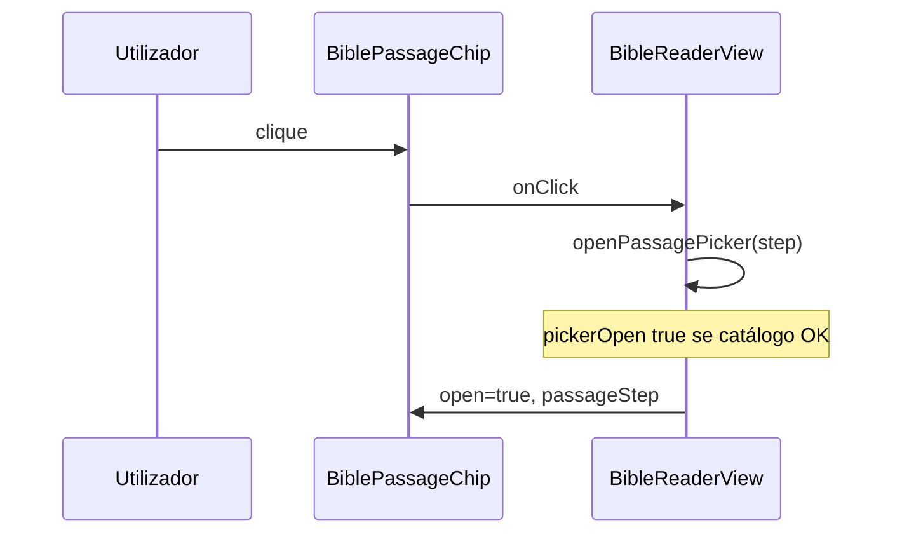

# Módulo: chips de livro e capítulo

| Campo | Valor |
|-------|--------|
| **ID** | `passage-chips` |
| **Superfície** | Dois botões na barra topo: livro (título) e capítulo (número) + caret |
| **Componente** | `BiblePassageChip` |
| **Dono do estado** | `BibleReaderView` (labels, loading, open, disabled) |

Cada chip abre o [passage roll](./passage-roll.md) no passo correspondente (`book` ou `chapter`). Não existe chip de versículo — o passo `verse` segue a escolha de capítulo.

---

## Resumo

- **Variantes:** `book` | `chapter` — classes `is-book` / `is-chapter` e placeholders tabulares distintos.
- **Hidratação:** `loading` ou label vazia → `is-hydrating`, botão `disabled`, `aria-busy`.
- **Aberto:** `open` quando roll aberto e `passageStep` coincide → `is-open`, `aria-expanded`, caret animado.
- **Acção:** `onClick` → `openPassagePicker("book" | "chapter")` (respeita `controlsDisabled` no pai).

---

## Mapa de ficheiros

| Papel | Caminho |
|-------|---------|
| Componente | `src/components/BiblePassageChip.tsx` |
| Montagem | `BibleReaderView.renderTopPassageNav` |
| Chrome derivado | `src/bible/viewState/bibleChrome.ts` |
| Estilos | `src/index.css` — `.bible-yv-passage-chip`, skeleton legado, modo narrow |

---

## Contrato (`BiblePassageChipProps`)

| Prop | Tipo | Uso |
|------|------|-----|
| `variant` | `"book" \| "chapter"` | Layout e placeholder |
| `label` | `string` | Texto visível (`bookTitle` ou `chapterId`) |
| `loading` | `boolean` | Hidratação (geralmente `pickerChrome.chipsHydrating`) |
| `open` | `boolean` | Roll aberto no passo deste chip |
| `disabled` | `boolean` | `controlsDisabled` ou hidratando |
| `ariaLabel` | `string` | FR — «Choisir un livre …» / «Choisir un chapitre …» |
| `title` | `string` | Tooltip quando não hidrata |
| `onClick` | `() => void` | Abrir picker |

### Lógica de label (`showSkeleton`)

```text
showSkeleton =
  loading
  OR (variant book AND !trimmed label)
  OR (variant chapter AND !trimmed label)
```

| Variant | Placeholder (tabular) | Largura estável |
|---------|----------------------|-----------------|
| `book` | `Livre` | evita salto no título |
| `chapter` | `88` | dígitos tabulares |

`visibleLabel = showSkeleton ? (trimmed || placeholder) : trimmed`

---

## Integração na barra

Estrutura em `renderTopPassageNav`:

```text
nav.bible-yv-top-passage
  div.bible-yv-top-passage-bar
    [opcional] seta skip_previous
    div.bible-yv-top-passage-segments
      BiblePassageChip book
      span divider
      BiblePassageChip chapter
    [opcional] seta skip_next
```

Props vindas de `pickerChrome`:

| Campo chrome | Prop chip |
|--------------|-----------|
| `chipsHydrating` | `loading` |
| `controlsDisabled` | `disabled` |

`open`:

- Livro: `passageRollOpen && passageStep === "book"`
- Capítulo: `passageRollOpen && passageStep === "chapter"`

A barra inteira recebe `is-hydrating` quando `pickerChrome.chipsHydrating`.

---

## Fluxo



Se `!pickerPanelOpenAllowed`, `openPassagePicker` é no-op; chip já aparece `disabled` via `controlsDisabled`.

---

## Estilos

| Classe | Significado |
|--------|-------------|
| `.bible-yv-passage-chip` | Base botão flex |
| `.is-book` / `.is-chapter` | Tipografia e min-width |
| `.is-open` | Estado roll no passo (caret rotação) |
| `.is-hydrating` | Placeholder sem `title`; caret atenuado |
| `.bible-yv-top.is-catalog-offline` | Ajuste label offline no topo |

Há CSS legado `.bible-yv-passage-chip-skeleton` — o chip actual usa placeholder no `.bible-yv-passage-chip-value` em vez de skeleton shimmer separado.

---

## Acessibilidade

| Atributo | Valor |
|----------|--------|
| `aria-expanded` | `open` |
| `aria-haspopup` | `"dialog"` |
| `aria-busy` | quando `showSkeleton` |
| `aria-label` | prop (inclui contexto livre/capítulo) |
| `disabled` | `disabled \|\| showSkeleton` |

**Foco:** ao abrir roll fora do passo `book`, `useEffect` foca `.bible-yv-passage-chip.is-chapter` (não o chip livro).

---

## Casos limite

| Situação | UI |
|----------|-----|
| S21 catálogo loading | «Livre» / «88», chips disabled |
| HT98 livros a carregar | mesmo via `biblePickerChrome` |
| `passageInFlight` | `controlsDisabled` — evita trocar ref durante fetch |
| Modo plano `is-compact` | barra compacta; chips mantêm contrato |
| Offline catalog hint | estilo muted em `.bible-yv-top.is-catalog-offline` |

---

## Alterações seguras

- Novos `ariaLabel` / copy FR no pai.
- Ajustes CSS de largura mínima por variant.
- Prop opcional futura (ex. ícone) — manter API mínima.

## Anti-padrões

- Terceiro chip «versículo» sem rever fluxo `passageStep` e foco.
- Permitir clique com label vazia sem hidratação (`showSkeleton` existe para isso).
- Passar `pickerOpen` directo a `open` — usar `passageRollOpen && passageStep` para reflectir painel real.
- Duplicar regras `chipsHydrating` no chip — manter em `biblePickerChrome`.

---

## Ligações

- [passage-roll.md](./passage-roll.md)
- [passage-discovery.md](./passage-discovery.md) — passo após chip livro
- [barra-seletor-versiculo.md](./barra-seletor-versiculo.md) — após chip capítulo
