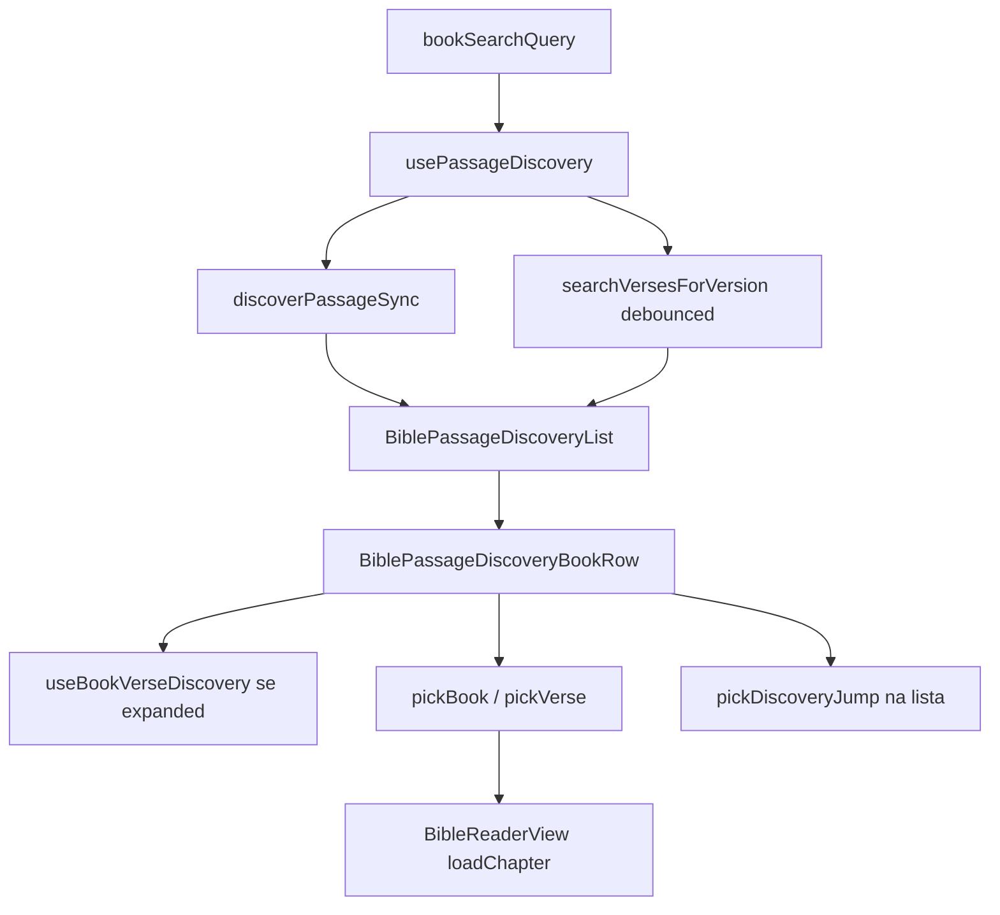

# Módulo: descoberta de passagem (passo livro)

| Campo | Valor |
|-------|--------|
| **ID** | `passage-discovery` |
| **Superfície** | Campo de busca + saltos de referência + listas AT/NT + linhas expansíveis com hits de versículo |
| **Dono do estado** | `BibleReaderView` (`bookSearchQuery`, `discoverySession`) |
| **Montagem** | Passo `book` em `BiblePassageScrollPicker` → `BiblePassageDiscoveryList` |

Activo apenas quando `passageRollOpen && passageStep === "book"` (`usePassageDiscovery` com `enabled`).

---

## Resumo

| Modo query | Comportamento |
|------------|----------------|
| Vazia | Catálogo por título, secções Ancien / Nouveau Testament |
| Referência parseável | Botões «Aller à …» (`DiscoveryJump`) — sem busca remota |
| Texto ≥ 2 chars | Debounce 280ms → contagens por livro + filtro título; livros com hits expandem |
| Livro expandido | `useBookVerseDiscovery` — até 48 versículos nesse livro |

Sessão UI (`PassageDiscoverySession`) persiste scroll da lista, livro expandido, scroll por livro e âncora USFM do último versículo escolhido.

---

## Mapa de ficheiros

| Papel | Caminho |
|-------|---------|
| Lista + saltos | `src/components/BiblePassageDiscoveryList.tsx` |
| Linha livro / painel versos | `src/components/BiblePassageDiscoveryBookRow.tsx` |
| Destaque query | `src/components/BibleSearchHighlight.tsx` |
| Campo busca | `BiblePassageScrollPicker` (passo `book`) |
| Hook lista | `src/hooks/usePassageDiscovery.ts` |
| Hook versos por livro | `src/hooks/useBookVerseDiscovery.ts` |
| Domínio sync | `src/bible/passageDiscovery/discoverPassageQuery.ts` |
| Normalização | `src/bible/passageDiscovery/normalizeQuery.ts` |
| Tipos | `src/bible/passageDiscovery/types.ts` |
| Sessão | `src/bible/passageDiscovery/session.ts` |
| Busca remota | `src/bible/passageForVersion.ts` → `searchVersesForVersion` |
| Referências | `src/youversion/bibleRefs.ts` (`passageJumpsFromQuery`) |
| Skeleton lista | `src/skeleton/presets/BiblePickerDiscoverySkeleton.tsx` |
| Skeleton snippet | `BibleVerseHitSnippetSkeleton` |

---

## Fluxo de dados

### `usePassageDiscovery`

1. Sempre aplica `discoverPassageSync(trimmed, books)` de imediato.
2. Se `!enabled`, para (roll fechado ou passo ≠ livro).
3. Query vazia → sem `busy`.
4. Se `buildDiscoveryJumps(trimmed)` tem itens → só saltos, sem API.
5. Se `trimmed.length < 2` → sem API.
6. Caso contrário: debounce, `searchVersesForVersion(textVersion, trimmed, 1)` para **contagens** agregadas; `buildPassageDiscoveryResult` com `bookCounts`.

`busy: true` durante debounce+fetch — mostra `BiblePickerDiscoverySkeleton` se `hasQuery`.

### `useBookVerseDiscovery`

- Só corre com `bookId` definido e query ≥ 2 caracteres.
- `searchVersesForVersion(..., VERSE_HIT_LIMIT=48, { books: [bookId] })`.
- `reqGen` cancela respostas antigas.

---

## Sessão (`PassageDiscoverySession`)

| Campo | Persistência |
|-------|--------------|
| `listScrollTop` | Restaurado em `BiblePassageScrollPicker` (`useLayoutEffect` na grelha livros) |
| `expandedBookId` | Livro com painel de versos aberto |
| `verseScrollByBook` | `scrollTop` por livro no painel |
| `anchorVerseUsfm` | Scroll/highlight do último versículo escolhido |

`clearBookSearch()` repõe `EMPTY_PASSAGE_DISCOVERY_SESSION`.

Updates de scroll usam `requestAnimationFrame` em `setDiscoveryListScroll` / `setDiscoveryVerseListScroll` para não saturar renders.

---

## Acções no leitor (`BibleReaderView`)

| Callback | Origem | Efeito |
|----------|--------|--------|
| `pickBook(id)` | Linha sem expansão | `loadChapter` se livro diferente; `passageStep → chapter` |
| `pickDiscoveryJump(jump)` | Saltos | Fecha picker; `loadChapter` com verso; `pendingVerseStep` se há verso |
| `pickVerseSearchHit(hit)` | Hit versículo | Fecha picker; parse USFM; `loadChapter` com verso; atualiza `anchorVerseUsfm` |
| `onPickVerse` (picker) | Lista | Grava scroll lista antes de delegar |

`handlePickVerse` no scroll picker: grava `listScrollTop` antes de `onPickVerse`.

---

## UI por peça

### `BiblePassageDiscoveryList`

- **Jumps:** `.bible-yv-pick-jumps`, `role="group"`, `aria-label="Références"`.
- **Busy:** skeleton preset partilhado.
- **Erro conteúdo:** `contentError` com query e sem jumps.
- **Secções:** `Ancien Testament` / `Nouveau Testament` com `.bible-yv-pick-section-label`.
- **Vazio:** «Aucun livre trouvé».

### `BiblePassageDiscoveryBookRow`

- Id estável: `id="bible-pick-book-${hit.id}"` (scroll-into-view no livro actual).
- `role="option"` na linha; `aria-selected` se livro actual da leitura.
- **Expandível:** query com hits de conteúdo (`hasQuery && count > 0`) — toggle expand; senão clique = `pickBook`.
- **Painel:** `role="group"`, lista `role="listbox"`, hits com `data-discovery-usfm`, classe `is-anchor` se bate `anchorVerseUsfm`.

`useLayoutEffect` restaura `verseScrollTop` ou faz `scrollIntoView` na âncora após carga.

---

## Contratos (lista → pai)

Props principais de `BiblePassageDiscoveryList` (ver ficheiro para lista completa):

- Entrada: `sections`, `jumps`, `busy`, `contentError`, `discoverySession` campos, `loading` (= `presentation.inFlight`).
- Saída: `onPickBook`, `onPickJump`, `onPickVerse`, `onExpandedBookChange`, `onVerseListScroll`.

---

## Estilos (selecção)

| Bloco | Classes |
|-------|---------|
| Busca | `.bible-yv-pick-roll-search`, `.bible-yv-pick-search` |
| Saltos | `.bible-yv-pick-jump` |
| Livro | `.bible-yv-pick-book-row`, `.bible-yv-pick-cell.is-book` |
| Painel versos | `.bible-yv-pick-verse-panel`, `.bible-yv-pick-verse-hit` |
| Grelha livros | `.bible-yv-pick-grid.is-books` |

---

## Acessibilidade

- Campo busca: `type="search"`, `aria-label` FR, clear com `aria-label="Effacer la recherche"`.
- Listbox principal no picker (passo book) envolve a lista.
- Painel versos: `aria-expanded` / `aria-controls` na linha expansível.
- Estados loading: `role="status"` («Chargement des versets…», erros, cap de resultados).

---

## Casos limite

| Situação | Comportamento |
|----------|----------------|
| Roll fecha | `enabled=false` — hook não dispara nova API |
| Query tipo «Jean 3:16» | Jumps sync — sem debounce |
| Versão HT98 vs S21 | `textVersion` em ambos os hooks |
| `inFlight` passagem | botões `disabled={loading}` na discovery |
| `total > hits.length` | Mensagem «n sur total résultats» no painel |
| Troca versão com query activa | Re-fetch via deps do hook |

---

## Alterações seguras

- Ajustar `DEBOUNCE_MS`, `MIN_CONTENT_CHARS`, `VERSE_HIT_LIMIT` com testes manuais de rede.
- Novos tipos de jump em `discoverPassageQuery` / `bibleRefs`.
- Copy FR e labels de secção.

## Anti-padrões

- Buscar versículos globais no passo livro sem passar `books: [bookId]` no painel — explosion de resultados.
- Ignorar `reqGen` — race com query rápida.
- Resetar sessão só no unmount — perder scroll ao fechar roll sem querer; hoje só `clearBookSearch` zera tudo.
- Activar discovery com roll fechado (`enabled` deve seguir `passageStep === "book"`).

---

## Ligações

- [passage-roll.md](./passage-roll.md)
- [passage-chips.md](./passage-chips.md) — abre passo livro
- [skeleton-architecture.md](../skeleton-architecture.md)
- [barra-seletor-versiculo.md](./barra-seletor-versiculo.md) — destino após capítulo
