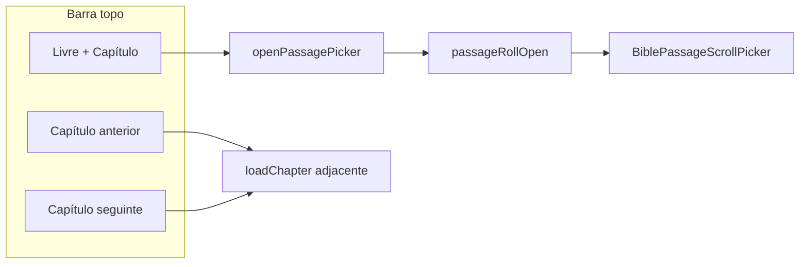

# Módulo: passage roll (barra + painel)

| Campo | Valor |
|-------|--------|
| **ID** | `passage-roll` |
| **Superfície** | Contentor no topo do leitor: barra livro/capítulo + painel deslizante (`book` / `chapter` / `verse`) |
| **Dono do estado** | `BibleReaderView` |
| **Renderização** | `renderPassageRoll` → `.bible-yv-passage-roll` |

Agrupa a navegação de referência bíblica e o painel do picker. O roll só **abre de facto** quando o catálogo permite (`passagePickerRollOpen`).

**Filhos documentados em separado:**

- [passage-chips.md](./passage-chips.md) — chips da barra
- [passage-discovery.md](./passage-discovery.md) — passo livro com busca
- [barra-seletor-versiculo.md](./barra-seletor-versiculo.md) — passo versículo

---

## Resumo

| Peça | Componente / função |
|------|---------------------|
| Barra compacta | `renderTopPassageNav` — setas capítulo + segmentos chips |
| Painel | `BiblePassageScrollPicker` |
| Abertura efectiva | `passageRollOpen = passagePickerRollOpen(pickerOpen, pickerPanelOpenAllowed)` |
| Fecho | `closePicker`, toque fora, scrim, `overlayDismissTarget` → `picker` |
| Integração leitor | `readerSurfaceChrome` — inert, scrim, classes root |

Variante **plano:** `renderPassageRoll(" is-plan-chrome")` no header com botão voltar do plano.

---

## Mapa de ficheiros

| Papel | Caminho |
|-------|---------|
| Orquestração UI | `src/components/BibleReaderView.tsx` |
| Painel multi-passo | `src/components/BiblePassageScrollPicker.tsx` |
| Chrome catálogo | `src/bible/viewState/bibleChrome.ts` (`biblePickerChrome`) |
| Roll aberto? | `src/bible/viewState/readerSurfaceChrome.ts` |
| Overlay dismiss | `overlayDismissTarget`, `OVERLAY_DISMISS_SWALLOW_MS` |
| Capítulo adjacente | `goAdjacent` + `adjacentChapter` (YouVersion) |
| Estilos | `src/index.css` — `.bible-yv-passage-roll`, `.is-passage-roll-open`, scrim |

---

## Estado local (`BibleReaderView`)

| Estado / ref | Função |
|--------------|--------|
| `pickerOpen` | Utilizador pediu abrir picker (chips ou fluxo interno) |
| `passageStep` | `"book" \| "chapter" \| "verse"` |
| `passageRollRef` | Foco, dismiss pointer-outside, scroll-into-view livro actual |
| `bookSearchQuery` | Campo busca no passo `book` |
| `discoverySession` | Scroll e expansão da descoberta (ver doc discovery) |
| `pendingVerseStep` | Após `pickChapter`, avança para `verse` quando carga termina |

### `pickerChrome` (`biblePickerChrome`)

Derivado de versão de texto, `catalogViewState`, HT98 loading e `presentation.inFlight`:

- `chipsHydrating` — barra em `is-hydrating`
- `pickerPanelOpenAllowed` — catálogo pronto
- `controlsDisabled` — chips/setas desactivados

### Abrir / fechar

```text
openPassagePicker("book" | "chapter") → setPassageStep + pickerOpen true
closePicker() → pickerOpen false, passageStep "book", pendingVerseStep false
```

`openPassagePicker` ignora se `!pickerChrome.pickerPanelOpenAllowed`.

---

## Fluxo do utilizador



1. **Chips** — abrem o roll no passo livro ou capítulo.
2. **Setas** — `goAdjacent(±1)`; se o picker já está aberto, força `passageStep` para `chapter` antes de navegar.
3. **Painel** — transições `book → chapter → verse` via `pickBook`, `pickChapter`, `handlePickBack`.
4. **Fecho** — escolha que navega (`jumpToVerse`, hits de busca) ou dismiss explícito.

---

## Superfície de leitura (`readerSurfaceChrome`)

Input derivado:

```ts
readerSurfaceChrome({
  pickerOpen,
  pickerPanelOpenAllowed: pickerChrome.pickerPanelOpenAllowed,
  toolsMenuOpen,
  historyOpen,
  shareSheetOpen,
  verseActionsOpen: showCreateCard,
})
```

Efeitos principais com roll aberto:

| Flag | Efeito |
|------|--------|
| `passagePickerRollOpen` | Classe `is-passage-roll-open` no reader e `.bible-yv-top` |
| `passageInputBlocked` | `inert` + `aria-hidden` na passagem; `is-overlay-occluding` na read-surface |
| `passageSurfaceScrimOpen` | Botão scrim «Fermer» |
| `scrimIsPickerDismiss` | Classe `is-picker-dismiss` quando roll aberto |
| `forceChromeVisible` | Impede esconder chrome por scroll enquanto overlay activo |

**Prioridade scrim** (`overlayDismissTarget`): `picker` → `tools` → `history` → `share`.

### Dismiss e «swallow»

- Toque **fora** do roll: listener `pointerdown` capture no `document` → `closePicker` + `markOverlayDismissSwallow`.
- **`OVERLAY_DISMISS_SWALLOW_MS` (480ms):** evita que o mesmo toque active versículos ou reabra UI (`takeOverlayDismissSwallow` em `selectVerse`, roll `onPointerDownCapture`).
- Scrim: `dismissPassageSurfaceOverlay()` com mesma prioridade.

### Ferramentas com roll fechado

`toolsMenuPassThroughDismiss`: toque na passagem com menu tools aberto fecha o menu (sem scrim de picker).

---

## Efeitos React relevantes

| Efeito | Comportamento |
|--------|----------------|
| Foco ao abrir | passo `book` → input busca; outros → chip capítulo |
| Scroll livro actual | passo `book` → `getElementById(bible-pick-book-${bookId})` centrado na grelha |
| `pendingVerseStep` | após `!presentation.inFlight` → `setPassageStep("verse")` |

---

## Estilos e layout

| Classe | Notas |
|--------|--------|
| `.bible-yv-passage-roll` | Contentor; `.is-open` expande painel |
| `.bible-yv-top-passage-bar` | Barra; `.is-roll-head`, `.is-roll-chrome-active`, `.is-compact` (plano) |
| `.bible-yv-passage-scroll-panel` | Painel picker (filho) |
| `.bible-yv-passage-roll-scrim` | Sobreposição na read-surface |
| `.bible-reader--yv.is-passage-roll-open` | Ajustes globais com roll |

Modo plano: `is-plan-chrome` / `is-plan-inline` reduzem chrome da barra (ver CSS).

---

## Acessibilidade

- Barra: `<nav aria-label="Livre et chapitre">`.
- Painel: `role="dialog"` no scroll picker (ver filhos).
- Scrim: `aria-label="Fermer"`.
- Passagem bloqueada: `inert` quando `passageInputBlocked`.
- Live region: `passageLiveStatusLabel` no topo (`sr-only`).

---

## Casos limite

| Situação | Comportamento |
|----------|----------------|
| Catálogo a carregar | `pickerOpen` pode ser true mas `passageRollOpen` false |
| `loadChapter` com picker aberto | Setas mudam capítulo; passo pode forçar `chapter` |
| Plano activo | Roll no header com back do plano; mesma lógica de picker |
| Retry erro passagem | Desactivado com `pickerOpen` |

---

## Alterações seguras

- Ajustar classes CSS do roll aberto sem mudar `passagePickerRollOpen`.
- Novos passos no picker: estender `PassagePickStep` e handlers em `BibleReaderView` (não só no filho).
- Melhorias de foco/teclado no painel.

## Anti-padrões

- Usar `pickerOpen` sozinho para `inert`/scrim — usar `readerSurfaceChrome` / `passageRollOpen`.
- Abrir painel sem `pickerPanelOpenAllowed` — utilizador vê chips bloqueados mas estado inconsistente.
- Remover swallow dismiss — reintroduz cliques fantasma em versículos.
- Duplicar `passagePickerRollOpen` noutros ficheiros — manter `readerSurfaceChrome.ts` como fonte única.

---

## Ligações

- [bible-offline-first-ui.md](../bible-offline-first-ui.md) — QA inert/scrim
- [passage-chips.md](./passage-chips.md)
- [passage-discovery.md](./passage-discovery.md)
- [barra-seletor-versiculo.md](./barra-seletor-versiculo.md)
